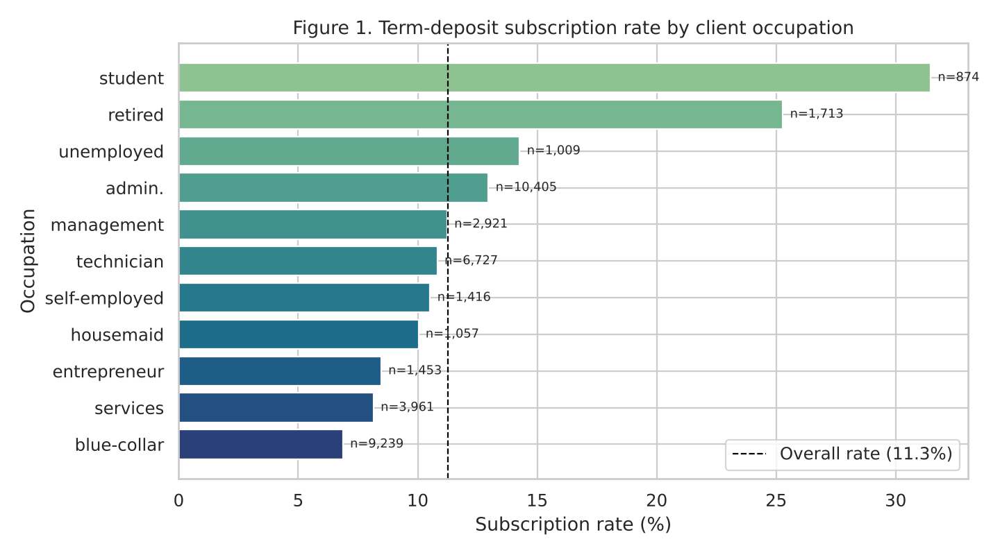
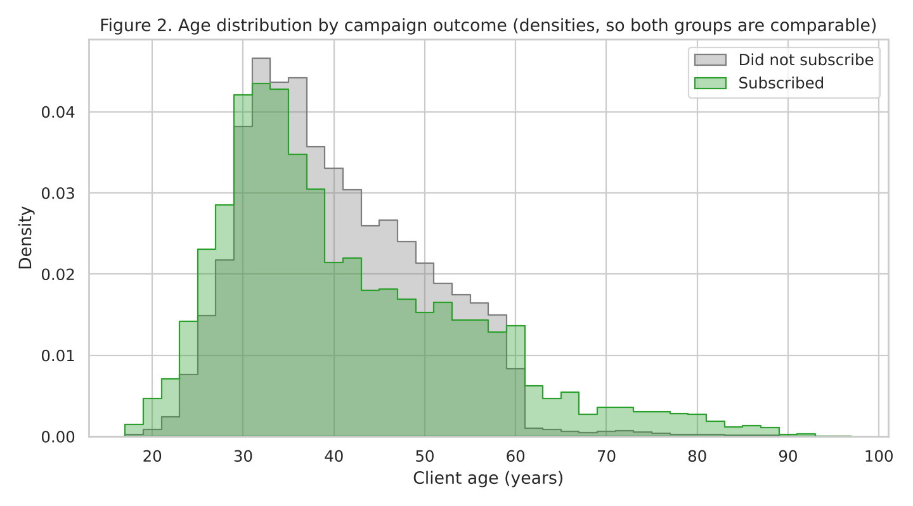
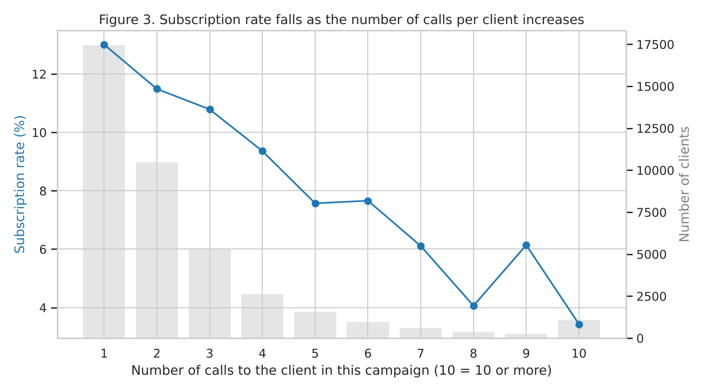

# Overview

This project builds a reproducible Python workflow that turns a raw banking-campaign extract into an analysis-ready table and a first descriptive picture of which clients subscribe to a term deposit. I used the **UCI Bank Marketing** dataset (Moro et al., 2012), file `bank-additional-full.csv`. It holds 41,188 phone contacts made by a Portuguese bank between May 2008 and November 2010: <https://archive.ics.uci.edu/dataset/222/bank+marketing>. The work is in `data_workflow.ipynb`: it loads the data, audits its quality, applies a documented cleaning pipeline built from reusable functions, explores the cleaned data with two EDA helpers, and produces the three figures discussed below. The code is version-controlled in the GitHub repository `ai-programming-foundations-project`, with separate branches for the cleaning and EDA work.

# Dataset Description

Each row is one phone contact with a client during a direct-marketing campaign. The target `y` records whether the client subscribed to a term deposit. The 20 inputs fall into four groups:

* **Client profile:** age, job, marital status, education, and whether the client has credit in default, a housing loan or a personal loan.
* **Current campaign contact:** contact channel, month, day of the week, call duration, and number of calls in this campaign (`campaign`).
* **Previous campaigns:** days since the last contact (`pdays`), number of earlier contacts (`previous`) and the earlier outcome (`poutcome`).
* **Macro-economic context:** employment variation rate, consumer price and confidence indices, Euribor 3-month rate and number employed.

The raw file has 41,188 rows and 21 columns, and no empty (NaN) cells. Missing answers are instead coded as the string "unknown" in six categorical columns:

* `default`: 8,597 rows (20.9%)
* `education`: 1,731 (4.2%)
* `housing` and `loan`: 990 each (2.4%), always on the same clients
* `job`: 330 (0.8%)
* `marital`: 80 (0.2%)

The audit also found 12 exact duplicate rows. In addition, 39,673 rows hold the placeholder `pdays = 999` instead of a real number of days. The target is strongly imbalanced, with 4,640 "yes" against 36,548 "no" in the raw file.

# Workflow Description

The notebook follows a linear, function-based pipeline so that every step can be re-run and reviewed:

1. **Load:** `load_bank_data()` reads the semicolon-separated file without changing any values.
2. **Audit:** `data_quality_report()` counts NaN and "unknown" values per column. Cross-tabulations then check how the unknowns overlap and what `pdays = 999` really means.
3. **Clean:** `clean_bank_data()` chains six functions and logs the row count after each step:
   * `standardize_columns()`: Python-friendly names and a 0/1 target `subscribed`
   * `remove_duplicates()`
   * `handle_unknowns()`
   * `encode_pdays()`
   * `cap_outliers()`
   * `set_categorical_types()`

   Assertions then confirm that the cleaned table has no duplicates, no unknown job or marital values, and a consistent contact flag.
4. **Explore:** `summarize_by_outcome()` compares numeric variables for subscribers and non-subscribers. `subscription_rate_by()` returns the subscription rate and the number of contacts for any categorical grouping, and it drives all three figures.
5. **Export:** the cleaned table (40,775 rows, 23 columns) is written to `data/bank_clean.csv`. A separate model-ready view excludes the leakage column `duration`.

# Key Decisions and Assumptions

* **Duplicates removed (12 rows).** The data has no client ID, so identical rows on all 21 columns are treated as accidental double entries. Keeping them would over-weight those contacts.
* **"unknown" in `job` and `marital` dropped (401 rows).** These are below 1% of the data, and an "unknown occupation" category would not support any useful conclusion. The function only drops values when a column's unknown share is at or below a 1% safety limit.
* **Other "unknown" values kept as their own category.** Imputing a guessed value would invent information, and the missingness itself may matter. For example, `default` has only 3 "yes" answers and 8,597 "unknown". A client who does not disclose their default status is plausibly different from one who answers "no".
* **`pdays = 999` turned into a missing value plus an explicit flag.** The audit showed that 999 is not a real day count. It applies to every never-contacted client, but also to 4,110 clients whose previous contact failed. I therefore set 999 to NaN (no day count recorded) and derived `previously_contacted` from `previous > 0`, which matches `poutcome != "nonexistent"` exactly. Leaving 999 in place would distort averages and plots.
* **Outliers in `campaign` capped, not deleted.** Values up to 56 calls are rare but genuine. I added `campaign_capped`, which clips at the 99th percentile (14 calls, 399 values affected), for summaries and plots, and kept the original column.
* **`duration` excluded from modelling features.** Call duration is known only after the call, and all 4 calls with a duration of 0 ended in "no". Using it to decide whom to call would leak the outcome, which is why Moro et al. (2014) also restrict their predictive model to information available before the call.
* **Assumption:** each row is treated as an independent contact. The same client may appear in more than one row, but without an ID this cannot be checked.

In total, 413 rows (1.0%) were removed. The overall subscription rate in the cleaned data is 11.26% (4,593 of 40,775).

# Results and Interpretation

{width=88%}

**Figure 1** shows a clear association between occupation and outcome. Students (31.5%, n = 874) and retired clients (25.3%, n = 1,713) subscribe at two to three times the overall rate of 11.3%. Blue-collar clients, the second-largest group (n = 9,239), have the lowest rate at 6.9%. The best-converting groups are small, so a campaign aimed only at them would reach few clients.

{width=88%}

**Figure 2** compares the age distributions as densities, so the much larger non-subscriber group does not hide the subscribers. The distributions overlap between roughly 25 and 60, but subscribers are over-represented at both ends: clients over 60 subscribe at 45.7% and those aged 17–25 at 20.7%, against 9.5% for ages 31–60. This is consistent with Figure 1, because age and occupation partly carry the same information.

{width=88%}

**Figure 3** shows diminishing returns from repeated calls. The subscription rate falls from 13.0% for clients called once (n = 17,444) to 3.4% for clients called ten or more times (n = 1,079). The small rise at nine calls rests on only 277 clients. Part of this pattern is structural: clients who subscribe stop being called. Even so, it suggests that capping calls per client would save effort and protect the client experience.

Two further results came from the EDA tables. Clients whose previous campaign succeeded subscribed at 65.6%, against 8.8% for clients never contacted before. The median 3-month Euribor rate was 1.27 for subscribers against 4.86 for non-subscribers, so economic conditions at the time of the call also mattered. All of these findings are associations in observational data, not causal effects.

# Responsible Practice

The data contains personal attributes (age, marital status, education, occupation) and financial-status indicators (default, loans). The patterns above could easily become targeting rules that treat groups differently: for example, calling older or retired clients far more often because they convert better, or not offering products to blue-collar clients. Mehrabi et al. (2021) describe how historical and representation bias in training data can lead to unfair outcomes once a model or rule is deployed. Here the past campaigns themselves shaped who was called and how often, so the data reflects the bank's earlier decisions as well as client preferences. Retired and older clients may also be more vulnerable to persuasive sales calls. A responsible next step would be to check outcomes and contact intensity by age group and occupation, to avoid using protected or proxy attributes as direct targeting criteria, and to put suitability checks in place for products sold to older clients. The "unknown" categories also deserve care: if one group refuses to disclose information more often than others, a model could learn to penalise that group indirectly.

# Reproducibility

Following the practices in Danchev (2022), the workflow is designed to be re-runnable end to end:

* The raw data file is stored unchanged in `data/`, and every transformation happens in code.
* Each step is a documented function, and assertions guard the key invariants.
* The notebook runs top to bottom without manual steps: `jupyter nbconvert --execute --inplace data_workflow.ipynb`.
* A fixed random seed is set, and `requirements.txt` pins the package versions used (pandas 3.0.5, seaborn 0.13.2, matplotlib 3.11.2, numpy 2.5.3).
* The work is version-controlled in Git, with feature branches merged into `main`.

One limitation is that the file was obtained from a public GitHub mirror of the UCI file because the UCI site could not be reached from the build environment. Its structure, row count (41,188) and value codes match the UCI description, and the SHA-256 checksum of the copy used is recorded in the README.

# Future Integration Reflections

For machine learning, the workflow would need a train/test split made *before* any data-dependent step such as quantile capping, encoders fitted on training data only, the removal of leakage variables like `duration`, and evaluation metrics that suit an 11% positive rate (precision, recall, PR-AUC rather than accuracy). Before training a neural network, I would check:

* the class balance
* consistent scaling of numeric inputs
* how categorical and "unknown" values are encoded
* that no future information leaks across time, since the data is ordered from 2008 to 2010

Agentic automation could help by re-running the audit and cleaning pipeline whenever a new campaign file arrives, and by flagging schema or distribution changes. It would be risky if an agent were allowed to choose cleaning rules, or which clients to call, without human review, because silent changes to how "unknown" or `pdays` are handled would change every downstream result.

# Sources

Danchev, V. (2022). Reproducible data science with Python: An open learning resource. *Journal of Open Source Education, 5*(56), 156. https://doi.org/10.21105/jose.00156

Mehrabi, N., Morstatter, F., Saxena, N., Lerman, K., & Galstyan, A. (2021). A survey on bias and fairness in machine learning. *ACM Computing Surveys, 54*(6), 1–35. https://doi.org/10.1145/3457607

Moro, S., Cortez, P., & Rita, P. (2014). A data-driven approach to predict the success of bank telemarketing. *Decision Support Systems, 62*, 22–31. https://doi.org/10.1016/j.dss.2014.03.001

Moro, S., Rita, P., & Cortez, P. (2012). *Bank marketing* [Data set]. UCI Machine Learning Repository. https://doi.org/10.24432/C5K306
